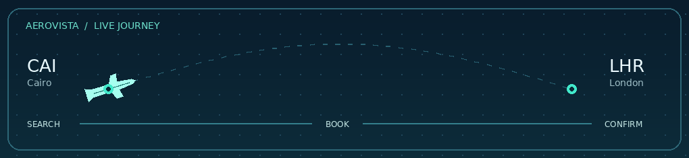
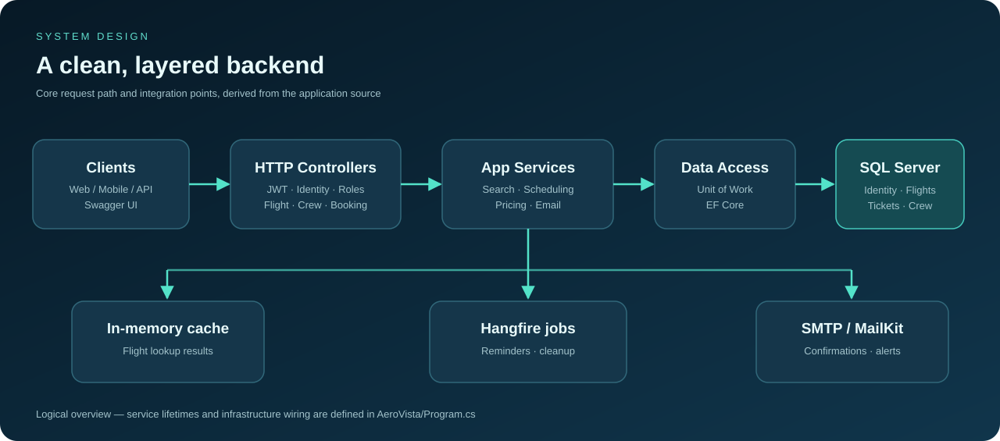
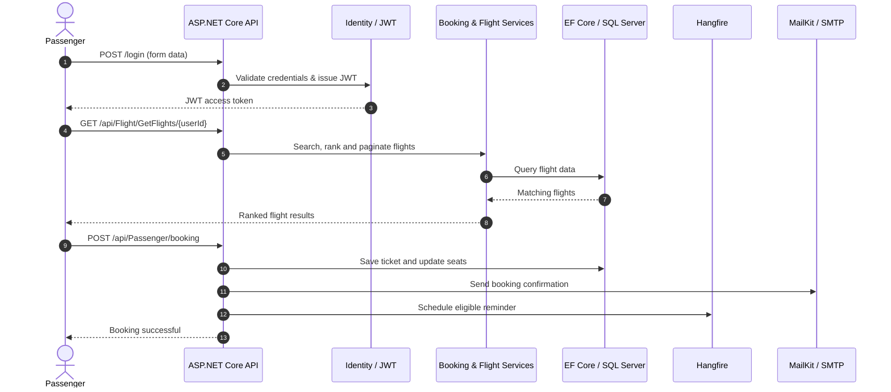

<div align="center">
  

  <p><strong>One backend for flight discovery, reservations, crew coordination, and travel notifications.</strong></p>

  <p>
    
    
    
    
    
  </p>

  <p>
    <a href="#-overview">Overview</a> ·
    <a href="#-features">Features</a> ·
    <a href="#-architecture">Architecture</a> ·
    <a href="#-getting-started">Getting started</a> ·
    <a href="#-api-reference">API reference</a> ·
    <a href="#-technical-notes">Technical notes</a>
  </p>
</div>

---

## ✨ Overview

**AeroVista** is an ASP.NET Core 8 REST API that models key airline operations: discovering flights, comparing routes based on traveler preferences, handling reservations, assigning crew members, and notifying passengers about their trips.

The solution separates HTTP controllers, business models and services, and data access into distinct projects. It uses **Entity Framework Core + SQL Server** for persistence, **ASP.NET Core Identity + JWT** for authentication, **Hangfire** for background jobs, and **MailKit** for transactional email.

<div align="center">
  
  <sub>Illustrative booking journey · Animated asset included in this repository</sub>
</div>

## 🚀 Features

| Module | What it does |
| :--- | :--- |
| 🔐 **Authentication & roles** | User registration, login, JWT issuance, email confirmation, password reset, and role management through ASP.NET Core Identity. |
| 🔎 **Smart flight discovery** | Filter flights by departure and arrival information, cache search results, and paginate the returned list. |
| 🎯 **Preference-based ranking** | Score and rank results using configurable weights for ticket **price** versus flight **duration**. |
| 💸 **Dynamic pricing** | Apply a one-time **30% increase** when an eligible flight is viewed within 24 hours of departure. |
| 🎟️ **Passenger bookings** | Reserve tickets, calculate totals, update ticket quantities, cancel reservations, and generate qualifying offers. |
| 👨‍✈️ **Crew coordination** | Find available crew members, assign or remove crew, and view upcoming crew trips. |
| 📅 **Flight scheduling** | Check airport departure slots and suggest alternatives around scheduling conflicts. |
| ✉️ **Transactional emails** | Send registration verification, booking confirmation, departure reminders, and flight cancellation messages with HTML templates. |
| ⚙️ **Background processing** | Schedule reminder emails and flight cleanup tasks with Hangfire and its SQL Server storage. |
| 📖 **Developer tooling** | Explore endpoints with Swagger UI, inspect scheduled jobs in the Hangfire dashboard, and access the bundled developer landing page. |

### How flight preferences work

The search service ranks available flights using normalized ticket price and trip duration:

```text
score = (priceWeight × normalizedPrice) + (durationWeight × normalizedDuration)
```

A **lower score** ranks higher in the response.

| User preference | Price weight | Duration weight |
| :--- | ---: | ---: |
| Cheapest flight | 1.0 | 0.0 |
| Mostly cheap | 0.7 | 0.3 |
| Balanced | 0.5 | 0.5 |
| Mostly fast | 0.3 | 0.7 |
| Fastest flight | 0.0 | 1.0 |

<details>
<summary><strong>💡 Example: how the flight booking lifecycle fits together</strong></summary>

1. A user registers and confirms their email address.
2. They log in and receive a JWT access token.
3. They search for flights, with results ordered by their selected price/speed preference.
4. They book a flight; the system persists the ticket and sends an HTML confirmation email.
5. For eligible future departures, a Hangfire job is scheduled for a reminder.
6. If an administrator cancels the flight, the system marks associated tickets for refund and sends cancellation notices.

> This describes the intended application flow. See [Technical notes](#-technical-notes) for implementation caveats that should be addressed before production use.

</details>

## 🏗️ Architecture



The solution follows a layered design with a **Repository / Unit of Work** abstraction:

```text
AeroVista.sln
├── AeroVista/                      # ASP.NET Core API / presentation
│   ├── Controllers/                # Authentication, Authorization, Crew, Flight, Passenger
│   ├── DTO/                        # Request / response contracts
│   ├── Services/                   # Search, scheduling, auth, email, cache, pricing support
│   ├── Infrastructures/            # Global exception handler
│   ├── Settings/                   # Mail configuration models
│   ├── wwwroot/                    # Developer portal and HTML email templates
│   ├── Program.cs                  # Dependency injection and middleware configuration
│   └── AeroVista.csproj
├── BusinessLogic/                  # Entities, enums, validation attributes and preferences
│   ├── Models/
│   └── BusinessLogic.csproj
└── DataAccess/                     # EF Core DbContext, migrations and repositories
    ├── Data/
    ├── Migrations/
    ├── Repositories/
    └── DataAccess.csproj
```

<details>
<summary><strong>🔍 Request flow (expand diagram)</strong></summary>



</details>

### Tech stack

| Area | Technologies |
| :--- | :--- |
| Framework | C#, .NET 8, ASP.NET Core Web API |
| Persistence | SQL Server, Entity Framework Core 8, migrations, lazy-loading proxies |
| Authentication | ASP.NET Core Identity, JWT Bearer authentication, role-based authorization |
| Background jobs | Hangfire with SQL Server storage |
| Email | MailKit, MimeKit, HTML templates |
| Mapping & caching | Mapster, `IMemoryCache` |
| API documentation | Swagger / Swashbuckle with annotations and JWT support |
| Additional infrastructure | Global exception handling and configured token-bucket rate-limit policy |

## 🛠️ Getting started

### Prerequisites

- **.NET 8 SDK**
- **SQL Server** (local instance, Docker container, or a reachable SQL Server instance)
- A suitable editor (Visual Studio, VS Code, or Rider)
- An **SMTP account** if you want registration, booking, and cancellation emails to work
- `dotnet-ef` CLI, for applying the existing EF Core migrations

### 1. Clone and restore

```bash
git clone https://github.com/YOUR_USERNAME/AeroVista-Airline-API.git
cd AeroVista-Airline-API
dotnet restore AeroVista.sln
```

> Replace `YOUR_USERNAME` with the owner of **your** GitHub repository. If you renamed the repository or solution folder, update the paths accordingly.

### 2. Configure local secrets

`AeroVista/Program.cs` expects `ConnectionStrings:DefaultConnection` and `JWT:Key` at startup. The project's configuration file leaves these values blank; provide them locally with **.NET User Secrets** rather than committing credentials.

Run these commands from the solution root (one command per line):

```bash
dotnet user-secrets set "ConnectionStrings:DefaultConnection" "Server=localhost;Database=AeroVistaDb;Trusted_Connection=True;TrustServerCertificate=True" --project AeroVista/AeroVista.csproj
dotnet user-secrets set "JWT:Key" "REPLACE_WITH_A_SECURE_RANDOM_SECRET_AT_LEAST_32_CHARACTERS" --project AeroVista/AeroVista.csproj
dotnet user-secrets set "MailSettings:Email" "your-smtp-address@example.com" --project AeroVista/AeroVista.csproj
dotnet user-secrets set "MailSettings:Password" "YOUR_SMTP_APP_PASSWORD" --project AeroVista/AeroVista.csproj
```

The SQL Server example uses **Windows integrated authentication**. If your SQL Server uses SQL credentials or runs in Docker, replace the connection string with the appropriate server, user, and password. The included mail settings default to Gmail SMTP on port 587; change `MailSettings:Host` and `MailSettings:Port` if you use another provider.

For deployed environments, use environment variables or a secrets manager, for example `ConnectionStrings__DefaultConnection` and `JWT__Key`. User Secrets are for local development only.

<details>
<summary><strong>⚙️ Required configuration keys</strong></summary>

| Configuration key | Purpose | Required? |
| :--- | :--- | :--- |
| `ConnectionStrings:DefaultConnection` | EF Core **and** Hangfire SQL storage | Yes |
| `JWT:Key` | JWT HMAC signing secret | Yes |
| `JWT:Issuer` | Token issuer | Yes (default exists in `appsettings.json`) |
| `JWT:Audience` | Token audience | Yes (default exists) |
| `JWT:DurationInDays` | JWT expiry period | Yes (default exists) |
| `MailSettings:Email` | SMTP sender account | For email features |
| `MailSettings:Password` | SMTP password / app password | For email features |
| `MailSettings:Host` | SMTP server | For email features (default exists) |
| `MailSettings:Port` | SMTP port | For email features (default exists) |

</details>

### 3. Apply the database migrations

```bash
dotnet tool install --global dotnet-ef --version "8.*"
dotnet ef database update --project DataAccess/DataAccess.csproj --startup-project AeroVista/AeroVista.csproj
```

If `dotnet-ef` is already installed, skip the install command. Ensure SQL Server is running and the account in your connection string can create or update the database.

**Role initialization:** registration assigns new accounts to the `User` role, while admin/crew endpoints require `Admin` and `Crew`. There is **no startup role seeder** in the provided source, so provision these Identity roles before using the relevant flows.

### 4. Start the API

```bash
dotnet run --project AeroVista/AeroVista.csproj --launch-profile https
```

With the included HTTPS launch profile, the local URLs are:

| Page | URL |
| :--- | :--- |
| Developer portal | `https://localhost:7000/` |
| Swagger UI | `https://localhost:7000/swagger` |
| OpenAPI JSON | `https://localhost:7000/swagger/v1/swagger.json` |
| Hangfire dashboard | `https://localhost:7000/dashboard` |

The development certificate may need to be trusted (`dotnet dev-certs https --trust`). **Do not expose the Hangfire dashboard publicly without adding authorization.**

## 📡 API reference

These are the routes **defined in the controllers**. Protected routes require `Authorization: Bearer <token>`. Some parameters are submitted as **form data**, and several booking parameters are bound from the **query string**.

### Authentication — `AuthenticationController`

| Method | Route | Purpose |
| :--- | :--- | :--- |
| `POST` | `/register` | Register an account (**form data**) |
| `POST` | `/login` | Authenticate and return a JWT (**form data**) |
| `GET` | `/api/Authentication/ConfirmEmail` | Verify a user's email address |
| `POST` | `/ResendCodeConfirmEmail` | Resend confirmation email (**form data**) |
| `POST` | `/ForgetPassword` | Start password-reset flow (**form data**) |
| `GET` | `/ResetPassword` | Complete password reset (see security note below) |

### Flights — `FlightController`

| Method | Route | Access | Purpose |
| :--- | :--- | :--- | :--- |
| `GET` | `/api/Flight/GetFlights/{userId}` | Authenticated | Search, rank, and paginate flights |
| `GET` | `/api/Flight/{id}` | Authenticated | Get one flight by ID |
| `GET` | `/api/Flight/GetAvailableFlightSchedule/{targetDateTime}` | Admin | Find available departure times; `airport` is a query parameter |
| `POST` | `/api/Flight` | Admin | Create a flight (JSON body) |
| `PUT` | `/api/Flight` | Admin | Update a flight (JSON body) |
| `PUT` | `/api/Flight/DeleteFlight/{flightId}` | Admin | Cancel a flight and notify affected passengers |

### Passenger bookings — `PassengerController`

| Method | Route | Purpose |
| :--- | :--- | :--- |
| `GET` | `/api/Passenger/GetUserInfo/{userId}` | Get passenger data |
| `GET` | `/api/Passenger/GetUserBooking/{userId}` | List bookings; accepts `status` query parameter |
| `POST` | `/api/Passenger/booking` | Book a flight; accepts `UserID`, `FlightID`, `TicketCount` |
| `PATCH` | `/api/Passenger` | Update booking quantity; accepts `UserID`, `TicketID`, `TicketCount` |
| `DELETE` | `/api/Passenger` | Cancel booking; accepts `UserID`, `TicketID` |

All passenger controller routes require authentication.

### Crew — `CrewController`

| Method | Route | Access | Purpose |
| :--- | :--- | :--- | :--- |
| `GET` | `/api/Crew/NextTrip` | Crew | List upcoming crew trips; accepts `UserID` |
| `GET` | `/api/Crew/GetAvailableCrew/{flightId}` | Admin | Find crew available for a flight |
| `POST` | `/api/Crew/{flightId}` | Admin | Assign a crew member (GUID in JSON body) |
| `DELETE` | `/api/Crew` | Admin | Remove a crew member from a flight |

### Role administration — `AuthorizationController`

| Method | Route | Purpose |
| :--- | :--- | :--- |
| `GET` | `/Authorization` | Get role names |
| `GET` | `/Authorization/{id}` | Get user role assignments |
| `POST` | `/Authorization` | Assign a role (**form data**) |
| `DELETE` | `/Authorization` | Remove a role (**form data**) |

All role administration routes require the `Admin` role.

<details>
<summary><strong>🧪 Sample API calls</strong></summary>

**Log in and receive a token** (the endpoint accepts `multipart/form-data` fields):

```bash
curl -k -X POST "https://localhost:7000/login" \
  -F "Email=passenger@example.com" \
  -F "Password=YOUR_PASSWORD"
```

**Query available flights** (use a real registered user's GUID and a departure time with available data):

```bash
curl -k -G "https://localhost:7000/api/Flight/GetFlights/YOUR_USER_GUID" \
  -H "Authorization: Bearer YOUR_JWT_TOKEN" \
  --data-urlencode "DepartureCountry=Egypt" \
  --data-urlencode "DepartureAirport=Cairo" \
  --data-urlencode "DepartureTime=2026-12-15T10:00:00" \
  --data-urlencode "pageNumber=1" \
  --data-urlencode "pageSize=10"
```

**Book a flight**:

```bash
curl -k -X POST "https://localhost:7000/api/Passenger/booking?UserID=YOUR_USER_GUID&FlightID=YOUR_FLIGHT_GUID&TicketCount=1" \
  -H "Authorization: Bearer YOUR_JWT_TOKEN"
```

`-k` bypasses TLS validation and is appropriate **only for local development** with an untrusted certificate. Prefer the Swagger UI for inspecting actual request schemas and responses. Example dates, IDs, accounts, and tokens above are placeholders, not seeded demo data.

</details>

## 🧰 Developer portal

The project includes a custom, static landing page at `AeroVista/wwwroot/index.html` with branding, feature highlights, links to `/swagger`, and a link to `/dashboard`. The source assets and email templates live in `AeroVista/wwwroot`.

The **README artwork** lives separately under [`assets/`](assets/) and is presentation-only; you don't need to modify the application to display it on GitHub.

## 🔒 Technical notes

This README documents features and routes visible in the source. **The project has not been independently built, tested, or deployed as part of producing this documentation.** Before considering it production-ready:

- **Protect the Hangfire dashboard.** `app.UseHangfireDashboard("/dashboard")` currently has no explicit dashboard authorization filter in `Program.cs`.
- **Enable or remove rate limiting deliberately.** The token-bucket policy is registered and applied as an attribute, but `app.UseRateLimiter()` is commented out, so the middleware is not active.
- **Redesign the password-reset flow.** The current reset link includes the new password in a GET URL; secrets should never be placed in URLs.
- **Validate resource ownership.** Some passenger endpoints accept arbitrary `UserID` values; authorization should check the JWT identity against the requested user/resource.
- **Review ticket/seat updates and reminder timing.** Booking currently decrements available seats by one regardless of `TicketCount`, and the reminder scheduling code does not apply the intended 24-hour subtraction to the scheduled delay.
- **Initialize roles and provide SMTP secrets** before using registration and email-driven flows.
- **Add automated tests** for authentication, booking transactions, inventory concurrency, pricing, and scheduling; no test project was present in the supplied solution.

## 📄 License

No `LICENSE` file was included in the provided project archive. Add one if you intend to define reuse terms for this repository.

---

<div align="center">
  <strong>✈ AeroVista</strong><br />
  <sub>Built with ASP.NET Core 8 · Designed around the airline booking lifecycle</sub>
</div>
